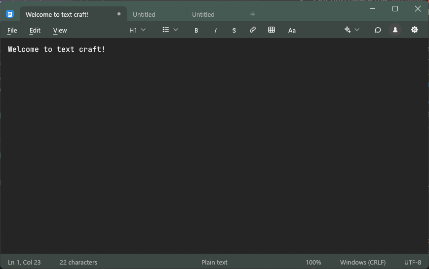

# TextCraft

A fast, modern text and Markdown editor for the desktop, written in Rust.

**[Website](https://rsxdalv.github.io/TextCraft/)** ·
**[Source](https://github.com/rsxdalv/TextCraft)** ·
**[Contributing](CONTRIBUTING.md)**

**[Download the latest release](https://github.com/rsxdalv/TextCraft/releases/latest)** for Windows, macOS or Linux; see
[Download](#download). TextCraft is in early development.



## What it does

**Your files stay safe**

- Atomic saves: a file is never overwritten until its replacement is safely written.
- Opens and saves common encodings, and keeps the line endings (CRLF, LF, CR) and
  byte-order mark a file already has.
- Close the app with unsaved work and it comes back as you left it: the previous
  session's tabs, including unsaved ones, reopen on the next start.

**Editing**

- Tabs you can reorder by dragging, with new-window and recent-files support.
- Multilevel undo and redo, word wrap, and drag-and-drop of text.
- Correct handling of Unicode, including emoji, combining marks and IME input.

**Find and navigate**

- Find, find next and previous, Replace and Replace All (as one undoable step),
  with match case and whole word options.
- Go to line.

**Markdown**

- A formatting toolbar for headings, lists, bold, italic, links and tables, and a
  rendered view of the document next to its source.

**Feels like a native app**

- One title row with the tabs and window buttons, Alt access keys on every menu,
  the system's own Open and Save dialogs, and light and dark themes.

## Download

Packages are on the [releases page](https://github.com/rsxdalv/TextCraft/releases/latest):

| Platform | Package |
| --- | --- |
| Windows x64 | `.msi` installer, or a portable `.zip` |
| macOS (Apple silicon and Intel) | `TextCraft.app` in a `.zip` |
| Linux x86_64 | `.tar.gz` with the program, a `.desktop` launcher and an icon (needs glibc 2.39 or newer) |

The builds are not code-signed, so the first launch asks you to confirm it. On Windows,
choose **More info**, then **Run anyway**. On macOS, open System Settings, Privacy &
Security, and choose **Open Anyway**. Each release lists SHA-256 checksums.

The Windows installer also registers TextCraft under the name `notepad`, so Win+R and the
Start menu's "notepad" open it instead of Windows Notepad. Uninstalling restores Notepad,
and the real `notepad.exe` is never touched.

## Build it yourself

You need [Rust](https://rustup.rs/) and Git on Windows, macOS or Linux.

```bash
git clone https://github.com/rsxdalv/TextCraft
cd TextCraft
cargo run --release -p nc-app
```

The executable is `textcraft`.

## Contributing

Build instructions, the checks to run, the architecture and the project status are
in [CONTRIBUTING.md](CONTRIBUTING.md).

## License

TextCraft is licensed under the MIT License; see [`LICENSE`](LICENSE).

The editor fonts it ships are separate works under the SIL Open Font License 1.1;
their licence texts are in [`crates/platform/assets/fonts`](crates/platform/assets/fonts).

Third-party code: the styled Markdown editing is adapted from AlienTechSoftware/notecraft
(MIT OR Apache-2.0); see [`THIRD_PARTY_NOTICES.md`](THIRD_PARTY_NOTICES.md).
